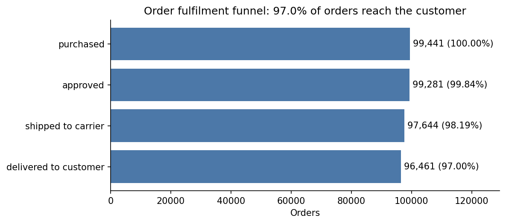
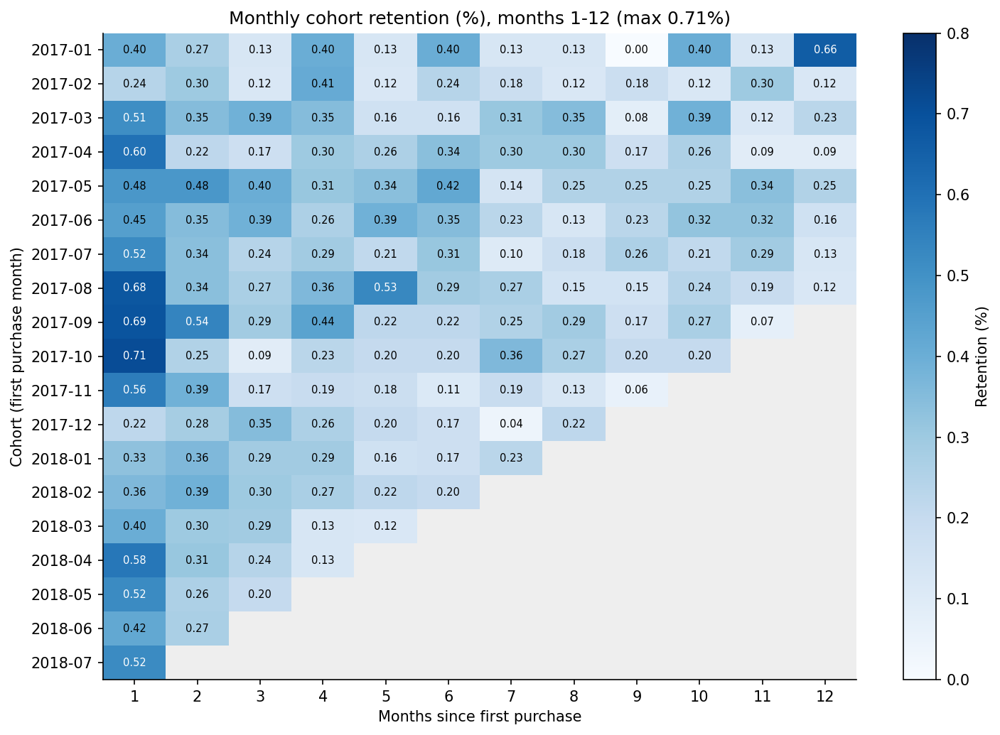
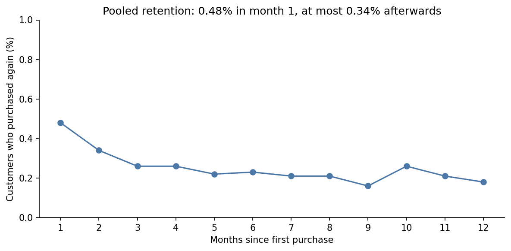
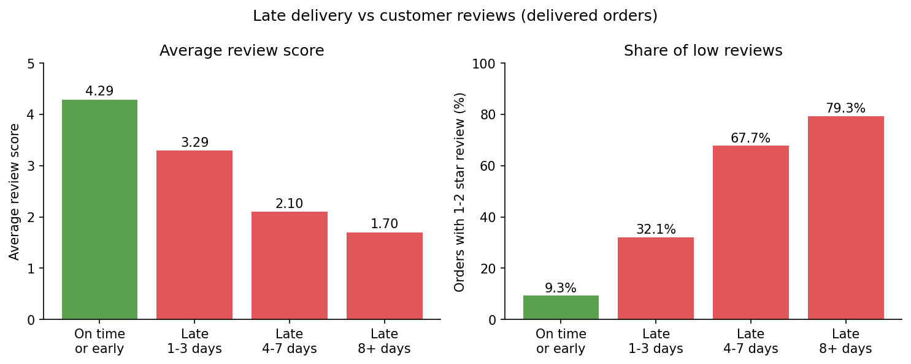
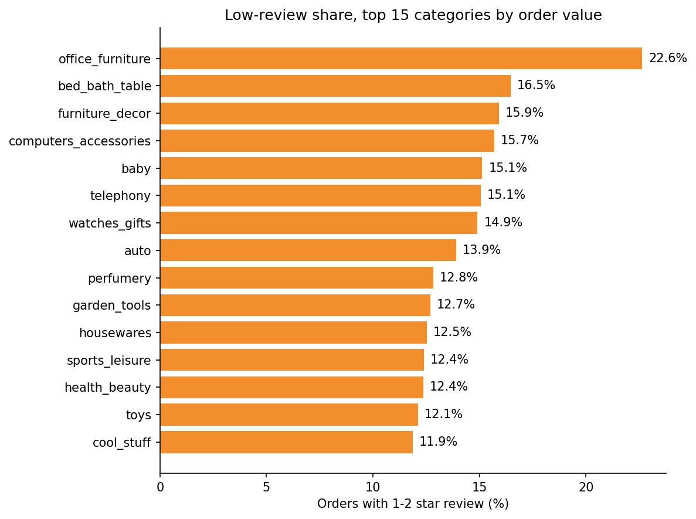

# Olist E-Commerce Analysis: Fulfilment Funnel, Retention and Late Deliveries

SQL analysis of 99,441 orders from the Olist Brazilian e-commerce dataset, ending in three prioritized product recommendations.

## TL;DR
- Fulfilment is healthy: 97.0% of orders reach the customer. The largest leak is between approval and carrier handover (1,637 orders).
- Customers rarely return: 0.48% buy again the next month, 1.77% within six months.
- Late delivery (6.8% of orders) is strongly associated with bad reviews (2.27 vs 4.29 average score) and is concentrated in RJ, BA and ES.

## Problem
Where do orders leak, do customers come back, and does delivery performance explain customer satisfaction? The goal is to turn these answers into product recommendations a product team could test.

## Dataset
[Olist Brazilian E-Commerce Public Dataset](https://www.kaggle.com/datasets/olistbr/brazilian-ecommerce) (Kaggle): 9 tables, 99,441 orders placed between 2016-09-04 and 2018-10-17. Check the license on the Kaggle page. Raw CSV files are not included in this repo.

## Approach
- **Stack:** SQLite, DBeaver, Python (pandas, matplotlib). All analysis logic is plain SQL (CTEs, window functions, views).
- **Data quality** (`sql/01_data_quality.sql`): no duplicate keys; 1,359 / 166 / 23 orders with out-of-order timestamps (kept in the funnel, excluded only from duration metrics); 551 extra review rows (kept the latest review per order); payments summed per order before joining.
- **Funnel:** stages are defined by timestamps, not by `order_status`, and are strictly sequential: purchased, approved, shipped to carrier, delivered.
- **Retention:** unit is `customer_unique_id` (96,096 real people vs 99,441 `customer_id`). Valid orders exclude canceled and unavailable. Cohort = first valid purchase month, 2017-01 to 2018-08 (20 cohorts, 94,697 customers). Retained in month N = purchased exactly N calendar months after the cohort month. Same-month purchases are not retention.
- **Late delivery:** delivery date later than the estimated date (date-level comparison), delivered orders only.

## Key findings

### 1. Funnel: 3.0% leakage, mostly before shipping


| Stage | Orders | % of purchased |
|---|---|---|
| Purchased | 99,441 | 100.00% |
| Approved | 99,281 | 99.84% |
| Shipped to carrier | 97,644 | 98.19% |
| Delivered | 96,461 | 97.00% |

The largest drop (1,637 orders, 55% of all leakage) is approved to shipped: unavailable 609, canceled 409, invoiced 314, processing 301. Unfinished orders are stale (average age 316-416 days at the data snapshot), so they are not in flight. Median time: 1.85 days approved to carrier, 7.1 days carrier to customer, 10.22 days purchase to delivery.

### 2. Retention is very low and flat



Pooled retention is 0.48% in month 1, 0.34% in month 2 and 0.16-0.26% in months 3-12. 1.77% of customers (976 of 55,227) buy again within six months. Repeat customers are 3.04% of customers but 5.66% of order value (about 1.9x value per customer).

### 3. Late delivery is strongly associated with bad reviews


6.77% of delivered orders (6,534 of 96,470) arrive late. Average review: 4.29 on time, 3.29 (1-3 days late), 2.10 (4-7 days), 1.70 (8+ days). Late orders account for roughly one third of all 1-2 star reviews (derived estimate).

### 4. Late delivery does not clearly reduce repeat purchase
Six-month repeat rate: 1.47% (54 of 3,667) for customers whose first order was late vs 1.79% (922 of 51,560) on time. The 0.32 pp gap has a 95% interval of roughly -0.1 to +0.7 pp, so the data show no clear effect.

### 5. Lateness is regional
RJ (12.11%), BA (12.16%) and ES (10.73%) are late far more often than SP (4.49%), and their reviews are lower (3.93-4.08 vs 4.25). Together they are about 18% of delivered orders but about 32% of late orders (derived from rounded percentages). Delay versus the promise matters more than raw delivery time: RS and RJ both average 15.3 days, but RS is late 6.08% of the time.

### 6. Category quality issues are not logistics


`office_furniture` has the highest low-review share (22.6%) and the lowest on-time review score (3.76 vs 4.15-4.45 elsewhere), while its late rate (8.07%) is close to other categories. Lateness does not explain it.

## Recommendations (RICE)
Reach comes from the data; Impact, Confidence and Effort are judgment estimates.

| # | Recommendation | Reach | Impact | Confidence | Effort (person-months) | RICE |
|---|---|---|---|---|---|---|
| 1 | Regional delivery-promise accuracy (buffered ETA and proactive delay notification, A/B test starting in RJ) | 17,601 orders | 2 | 70% | 2 | 12,321 |
| 2 | Post-delivery re-engagement for repeat purchase (randomized holdout) | 94,990 customers | 0.5 | 40% | 4 | 4,750 |
| 3 | Detect and resolve orders stuck before carrier handover | 1,637 orders | 1 | 50% | 3 | 273 |

Success metrics: (1) late rate in test regions (RJ baseline 12.11%) and share of 1-2 star reviews, with checkout conversion as a guardrail; (2) six-month repeat rate (baseline 1.77%); (3) share of approved orders without carrier handover within a time limit (baseline 1.65%).

## How to reproduce
```bash
pip install -r requirements.txt
# 1. Download the dataset from Kaggle and extract the 9 CSV files into data/
python scripts/load_data.py          # creates olist.db
# 2. Run sql/00 ... sql/05 in order (DBeaver or sqlite3); export results to output/
python scripts/make_charts.py        # writes assets/charts/*.png
```
`03_retention_cohort.sql` creates the view `v_cohort_retention` and `04_segmentation.sql` creates `v_order_base`; `05_extra_analysis.sql` depends on the latter.

## Limitations
- Observational data: findings are associations, not causal effects. Recommendations need experiments.
- The dataset ends in 2018: cohorts after 2018-08 and months with very few orders (2016) are excluded; retention months 13+ rest on under 25 customers and are not shown.
- About 30% of repeat customers placed their second order on the same day (869 of 2,888), possibly split orders. Cohort retention ignores these by design.
- Order value is the sum of payments (includes freight). Orders with several categories are attributed to the category of the highest-priced item.
- 768 orders have no review. Lateness is measured against the platform's own estimate.
- Unverified hypotheses: the November 2017 volume peak (7,544 orders) may be Black Friday, and unavailable orders may be stock-outs.

## Repository structure
`data/` (not tracked) · `sql/` queries 00-05 · `scripts/` loader and charts · `output/` query results · `assets/charts/` figures · `docs/` working notes

Data: Olist, via Kaggle.